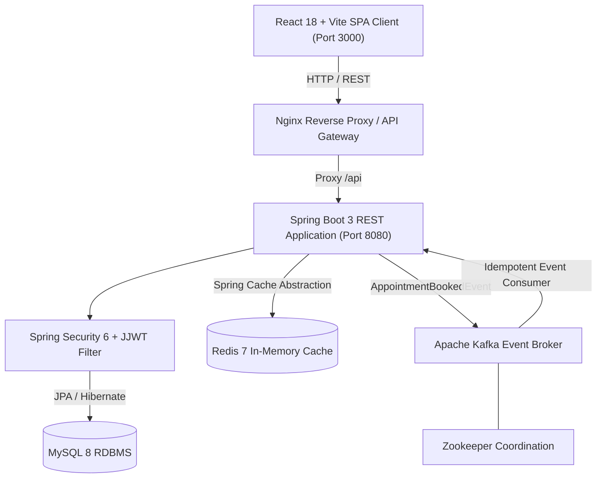
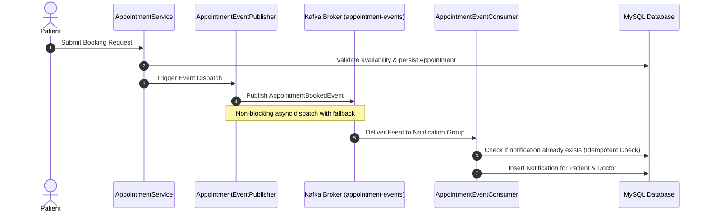

# Hospital Management System (HMS) — System Architecture

## 1. System Overview

PulseCare Hospital Management System is a resilient, enterprise-grade healthcare platform built using modern layered software engineering principles. The system enforces strict Role-Based Access Control (RBAC) across three distinct actors: **System Administrators**, **Doctors/Physicians**, and **Patients**.



---

## 2. Layered Backend Architecture

The backend follows Domain-Driven layered architecture with strict separation of concerns:

- **`config`**: Infrastructure and system-level configuration beans (`SecurityConfig`, `RedisCacheConfig`, `KafkaConfig`, `DataInitializer`).
- **`security`**: Authentication filters, JWT provider, UserPrincipal, and custom UserDetailsService.
- **`controller`**: REST controllers exposing endpoints with Bean Validation (`@Valid`) and Spring Security annotations (`@PreAuthorize`).
- **`service`**: Core business logic, transaction boundaries (`@Transactional`), schedule slot calculations, and authorization enforcement.
- **`repository`**: Spring Data JPA repositories with custom JPQL queries, indexing, and conflict overlap checks.
- **`entity`**: Relational database entity mappings with optimistic locking (`@Version`) and lifecycle hooks (`@PrePersist`, `@PreUpdate`).
- **`dto`**: Data Transfer Objects strictly isolating the internal database schema from client payloads.
- **`mapper`**: Type-safe translation between entities and DTOs.
- **`exception`**: Centralized `@RestControllerAdvice` converting exceptions to standard RFC-compliant JSON responses.
- **`event`**: Event producer, consumer, and event payloads for Kafka asynchronous processing.
- **`audit`**: Asynchronous security and administrative audit trail logging.

---

## 3. Security and Authentication Pipeline

1. **Authentication**: Users submit credentials (`email`, `password`) via `/api/auth/login`. Passwords are encrypted and verified using `BCryptPasswordEncoder`.
2. **Token Generation**: Upon successful authentication, a signed JWT (HMAC-SHA256) is issued containing the user ID, email, role, and expiration timestamp.
3. **Stateless Request Interception**: `JwtAuthenticationFilter` intercepts incoming requests, parses the `Bearer` token from the `Authorization` header, verifies its cryptographic signature and expiration, and establishes the `SecurityContext`.
4. **Method-Level RBAC**: Endpoints are defended with `@PreAuthorize("hasRole('ADMIN')")`, `@PreAuthorize("hasRole('DOCTOR')")`, or `@PreAuthorize("hasRole('PATIENT')")`.
5. **Ownership Enforcement**: Doctors can only access appointments assigned to them; patients can only view their own medical records and cancel their own bookings.

---

## 4. Concurrency-Safe Appointment Booking

To guarantee that doctors and patients cannot be double-booked during concurrent booking requests:

1. **Isolation Level**: Booking methods operate within `@Transactional(isolation = Isolation.READ_COMMITTED)`.
2. **Doctor Schedule Boundary**: The requested appointment must fall inside the doctor's declared `DoctorAvailability` window (`startTime >= avail.startTime && endTime <= avail.endTime`).
3. **Doctor Overlap Conflict Detection**: An atomic JPQL count query checks for overlapping active appointments:
   ```sql
   SELECT COUNT(a) FROM Appointment a 
   WHERE a.doctor.id = :doctorId 
     AND a.status NOT IN ('CANCELLED') 
     AND a.startTime < :endTime 
     AND a.endTime > :startTime
   ```
4. **Patient Overlap Conflict Detection**: A simultaneous check validates that the patient does not already have a conflicting booking at the same time.
5. **Optimistic Locking**: The `Appointment` entity includes a `@Version` field to prevent lost updates during concurrent status changes.
6. **Conflict Response**: If an overlap is detected, the transaction aborts with an `AppointmentConflictException` returning HTTP 409 Conflict.

---

## 5. Event-Driven Kafka Notification Pipeline



- **Topic**: `appointment-events` (partitioned for scalability).
- **Consumer Group**: `hms-notification-group`.
- **Fault-Tolerance**: If Kafka is temporarily unreachable, `AppointmentEventPublisher` automatically falls back to an internal Spring application event bus to guarantee notification delivery.
- **Idempotency**: `AppointmentEventConsumer` verifies `existsByUserIdAndAppointmentIdAndNotificationType` before inserting notifications, preventing duplicates during network re-deliveries.

---

## 6. Redis Caching Strategy

- **Target Data**: Read-heavy, non-sensitive public assets:
  - Doctor profiles: `@Cacheable(value = "doctorProfiles", key = "#id")`
  - Medical specializations: `@Cacheable(value = "specializations")`
- **Cache Invalidation**: Whenever a doctor is created, updated, activated or deactivated, `@CacheEvict(value = {"doctorProfiles", "specializations"}, allEntries = true)` purges stale entries.
- **Graceful Error Handling**: `RedisCacheConfig` implements `CacheErrorHandler`. If Redis is offline or encounters connection failures, cache misses fall through gracefully to the relational database without disrupting client traffic.
