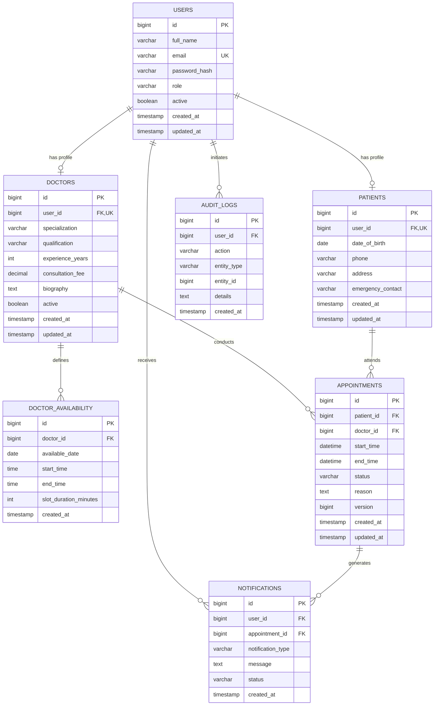

# Hospital Management System (HMS) — Database Schema

## 1. Entity Relationship Diagram (ERD)

---

## 2. Table Specifications

### 2.1 `users`
Stores system accounts for all three roles (`ADMIN`, `DOCTOR`, `PATIENT`).

| Column | Type | Constraints | Description |
|---|---|---|---|
| `id` | BIGINT | PRIMARY KEY, AUTO_INCREMENT | Unique user identifier |
| `full_name` | VARCHAR(100) | NOT NULL | User's legal full name |
| `email` | VARCHAR(150) | NOT NULL, UNIQUE, INDEX | Unique login credential |
| `password_hash` | VARCHAR(255) | NOT NULL | BCrypt password hash |
| `role` | VARCHAR(20) | NOT NULL, INDEX | ADMIN, DOCTOR, or PATIENT |
| `active` | BOOLEAN | NOT NULL, DEFAULT TRUE | Account lock / activation flag |
| `created_at` | TIMESTAMP | DEFAULT CURRENT_TIMESTAMP | Registration timestamp |
| `updated_at` | TIMESTAMP | ON UPDATE CURRENT_TIMESTAMP | Modification timestamp |

---

### 2.2 `patients`
Stores demographic, contact, and emergency details linked to a user account.

| Column | Type | Constraints | Description |
|---|---|---|---|
| `id` | BIGINT | PRIMARY KEY, AUTO_INCREMENT | Patient identifier |
| `user_id` | BIGINT | UNIQUE, FK `users.id` (CASCADE) | Associated user account |
| `date_of_birth` | DATE | NULLABLE | Birth date |
| `phone` | VARCHAR(30) | NULLABLE | Primary contact number |
| `address` | VARCHAR(255) | NULLABLE | Residential address |
| `emergency_contact` | VARCHAR(100) | NULLABLE | Emergency contact name & phone |
| `created_at` | TIMESTAMP | DEFAULT CURRENT_TIMESTAMP | Creation timestamp |
| `updated_at` | TIMESTAMP | ON UPDATE CURRENT_TIMESTAMP | Last update timestamp |

---

### 2.3 `doctors`
Contains physician professional credentials, department specialization, consultation fee, and active status.

| Column | Type | Constraints | Description |
|---|---|---|---|
| `id` | BIGINT | PRIMARY KEY, AUTO_INCREMENT | Doctor identifier |
| `user_id` | BIGINT | UNIQUE, FK `users.id` (CASCADE) | Associated user account |
| `specialization` | VARCHAR(100) | NOT NULL, INDEX | Medical department (e.g. Cardiology) |
| `qualification` | VARCHAR(150) | NULLABLE | Degrees (MD, PhD, MBBS) |
| `experience_years` | INT | NOT NULL, DEFAULT 0 | Years of clinical practice |
| `consultation_fee` | DECIMAL(10,2) | NOT NULL, DEFAULT 0.00 | Consultation price per visit |
| `biography` | TEXT | NULLABLE | Physician background / bio |
| `active` | BOOLEAN | NOT NULL, DEFAULT TRUE, INDEX | Roster active status |
| `created_at` | TIMESTAMP | DEFAULT CURRENT_TIMESTAMP | Onboarding timestamp |
| `updated_at` | TIMESTAMP | ON UPDATE CURRENT_TIMESTAMP | Last update timestamp |

---

### 2.4 `doctor_availability`
Configures daily consultation windows for each doctor.

| Column | Type | Constraints | Description |
|---|---|---|---|
| `id` | BIGINT | PRIMARY KEY, AUTO_INCREMENT | Availability record identifier |
| `doctor_id` | BIGINT | NOT NULL, FK `doctors.id` (CASCADE) | Physician foreign key |
| `available_date` | DATE | NOT NULL | Shift date |
| `start_time` | TIME | NOT NULL | Shift start (e.g. 09:00:00) |
| `end_time` | TIME | NOT NULL | Shift end (e.g. 17:00:00) |
| `slot_duration_minutes` | INT | NOT NULL, DEFAULT 30 | Interval length per consultation |
| `created_at` | TIMESTAMP | DEFAULT CURRENT_TIMESTAMP | Record creation timestamp |

**Indexes**: `(doctor_id, available_date)` for fast schedule lookups.

---

### 2.5 `appointments`
Represents scheduled consultations between patients and doctors.

| Column | Type | Constraints | Description |
|---|---|---|---|
| `id` | BIGINT | PRIMARY KEY, AUTO_INCREMENT | Appointment identifier |
| `patient_id` | BIGINT | NOT NULL, FK `patients.id` | Patient foreign key |
| `doctor_id` | BIGINT | NOT NULL, FK `doctors.id` | Doctor foreign key |
| `start_time` | DATETIME | NOT NULL | Scheduled start timestamp |
| `end_time` | DATETIME | NOT NULL | Scheduled end timestamp |
| `status` | VARCHAR(30) | NOT NULL, DEFAULT 'PENDING' | CONFIRMED, COMPLETED, CANCELLED |
| `reason` | TEXT | NULLABLE | Chief medical complaint / notes |
| `version` | BIGINT | NULLABLE | Optimistic locking version |
| `created_at` | TIMESTAMP | DEFAULT CURRENT_TIMESTAMP | Booking submission timestamp |
| `updated_at` | TIMESTAMP | ON UPDATE CURRENT_TIMESTAMP | Last status modification timestamp |

**Indexes**:
- `idx_appointments_doc_time (doctor_id, start_time)`
- `idx_appointments_patient (patient_id)`
- `idx_appointments_status (status)`

---

### 2.6 `notifications`
Stores persistent notifications generated by asynchronous Kafka appointment events.

| Column | Type | Constraints | Description |
|---|---|---|---|
| `id` | BIGINT | PRIMARY KEY, AUTO_INCREMENT | Notification identifier |
| `user_id` | BIGINT | NOT NULL, FK `users.id` (CASCADE) | Target recipient user |
| `appointment_id` | BIGINT | NULLABLE, FK `appointments.id` (SET NULL) | Associated booking |
| `notification_type` | VARCHAR(50) | NOT NULL | APPOINTMENT_BOOKED, CANCELLED, etc. |
| `message` | TEXT | NOT NULL | Human-readable notification text |
| `status` | VARCHAR(20) | NOT NULL, DEFAULT 'UNREAD' | UNREAD or READ |
| `created_at` | TIMESTAMP | DEFAULT CURRENT_TIMESTAMP | Dispatch timestamp |

**Indexes**: `(user_id, status)` for fast badge count and inbox pagination.

---

### 2.7 `audit_logs`
Compliance audit log tracking system actions.

| Column | Type | Constraints | Description |
|---|---|---|---|
| `id` | BIGINT | PRIMARY KEY, AUTO_INCREMENT | Audit record identifier |
| `user_id` | BIGINT | NULLABLE, FK `users.id` | User performing the action |
| `action` | VARCHAR(100) | NOT NULL | USER_LOGIN, BOOK_APPOINTMENT, etc. |
| `entity_type` | VARCHAR(50) | NOT NULL | Appointment, Doctor, Patient, User |
| `entity_id` | BIGINT | NULLABLE | Target entity primary key |
| `details` | TEXT | NULLABLE | Supplemental context / description |
| `created_at` | TIMESTAMP | DEFAULT CURRENT_TIMESTAMP | Action execution timestamp |

**Indexes**: `(entity_type, entity_id)`, `(user_id)`.
